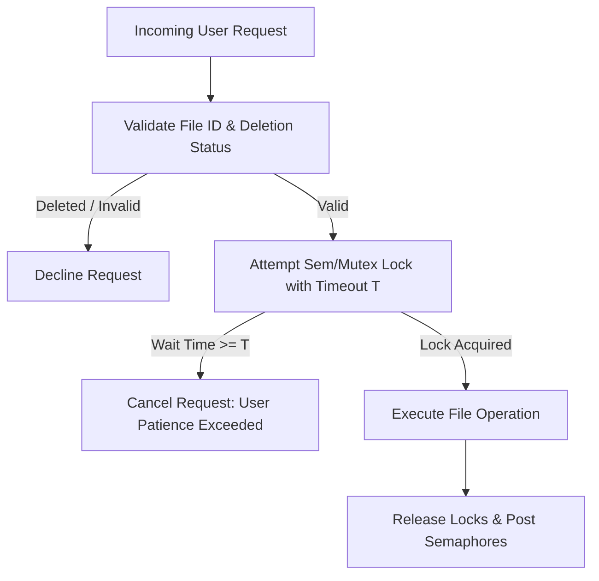
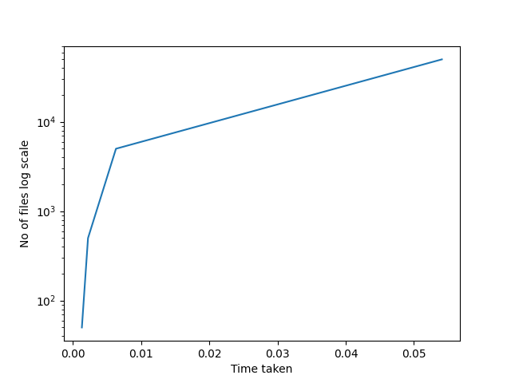
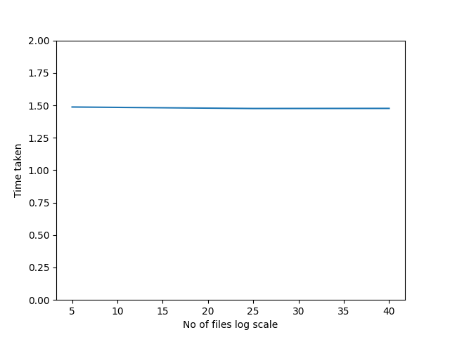
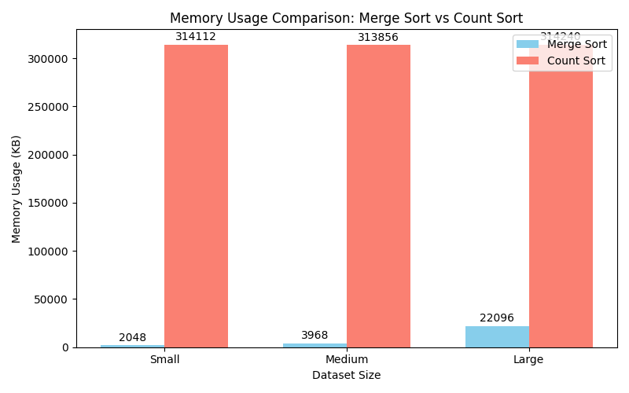

# xv6 Copy-on-Write (COW) Fork & Multi-Threaded Concurrency

[](https://github.com/OSN-Monsoon-2024)
[](https://en.wikipedia.org/wiki/C_(programming_language))
[](https://github.com/mit-pdos/xv6-riscv)
[](https://pubs.opengroup.org/onlinepubs/7908799/xsh/pthread.h.html)

A systems programming project developed for the **Operating Systems and Networks (OSN Monsoon 2024)** course at IIIT Hyderabad. The project tackles two foundational operating systems challenges:

1. **Kernel Virtual Memory Optimization**: Implementing **Copy-on-Write (COW) Fork** and Page Fault Tracking in the RISC-V **xv6** operating system kernel.
2. **User-Space Concurrency & Distributed Processing**: Designing and benchmarking multi-threaded synchronization for concurrent file access (**LazyRW**) and parallel distributed sorting algorithms (**LazyS**).

---

## Table of Contents

- [Overview](#overview)
- [Repository Structure](#repository-structure)
- [Part 1: xv6 Copy-on-Write (COW) Fork](#part-1-xv6-copy-on-write-cow-fork)
  - [Motivation & Problem Statement](#motivation--problem-statement)
  - [Design & Implementation](#design--implementation)
    - [1. Physical Page Reference Counting (`kernel/kalloc.c`)](#1-physical-page-reference-counting-kernelkallocc)
    - [2. Page Table Sharing & Software Flags (`kernel/vm.c`)](#2-page-table-sharing--software-flags-kernelvmc)
    - [3. Page Fault Trap Handler (`kernel/trap.c`)](#3-page-fault-trap-handler-kerneltrapc)
    - [4. Kernel Buffer Copyout Handling (`kernel/vm.c`)](#4-kernel-buffer-copyout-handling-kernelvmc)
    - [5. System Calls for Page Fault Profiling](#5-system-calls-for-page-fault-profiling)
  - [Testing & Verification](#testing--verification)
  - [COW Performance & Optimization Analysis](#cow-performance--optimization-analysis)
- [Part 2: Concurrency & Synchronization](#part-2-concurrency--synchronization)
  - [1. LazyRW: Multi-Threaded File Access Management](#1-lazyrw-multi-threaded-file-access-management)
    - [Design & Synchronization Mechanisms](#design--synchronization-mechanisms)
    - [User Patience & Timeout Handling](#user-patience--timeout-handling)
  - [2. LazyS: Distributed / Parallel Sorting](#2-lazys-distributed--parallel-sorting)
    - [Distributed Merge Sort](#distributed-merge-sort)
    - [Distributed Count Sort](#distributed-count-sort)
    - [Benchmark & Complexity Analysis](#benchmark--complexity-analysis)
    - [Performance Visualizations](#performance-visualizations)
- [Getting Started & Build Instructions](#getting-started--build-instructions)
  - [Prerequisites](#prerequisites)
  - [Building and Running xv6](#building-and-running-xv6)
  - [Compiling and Running Concurrency Modules](#compiling-and-running-concurrency-modules)
- [Authors & Acknowledgments](#authors--acknowledgments)

---

## Overview

Modern operating systems defer costly operations until strictly necessary ("lazy allocation"). This repository implements lazy resource management at two layers:

```
+-------------------------------------------------------------------------+
|                              LAZY™ CORP                                 |
+------------------------------------+------------------------------------+
|  Part 1: Kernel Space (xv6-riscv)  |    Part 2: User Space (Linux)      |
+------------------------------------+------------------------------------+
| • Copy-on-Write (COW) Fork         | • LazyRW: Reader-Writer-Deleter    |
| • Physical Page Reference Counting |   file access with timeouts        |
| • Store Page Fault Interception    | • LazyS: Multi-threaded Merge Sort |
| • COW Profiling System Calls       | • LazyS: Multi-threaded Count Sort |
+------------------------------------+------------------------------------+
```

---

## Repository Structure

```text
xv6-COW-and-Concurrency/
├── README.md                           # Master project documentation
├── .gitignore                          # Build artifacts and temporary file filters
├── concurrency/                        # Concurrency and parallel processing module
│   ├── LazyRW.c                        # Multi-threaded file reader/writer/deleter
│   ├── LazyS.c                         # Distributed Merge and Count sort engine
│   ├── measure.sh                      # Benchmark script for execution time & memory
│   ├── README.md                       # Concurrency benchmark report & writeup
│   ├── TimeMerge.png                   # Merge Sort performance curve
│   ├── TimeCount.png                   # Count Sort performance curve
│   └── bargraph_mem.png                # Memory consumption comparison chart
└── initial-xv6/                        # xv6-riscv operating system kernel
    ├── README.md                       # xv6 original documentation
    └── src/
        ├── Makefile                    # Build automation for xv6
        ├── report_xv6.md               # COW analysis and evaluation report
        ├── kernel/                     # xv6 kernel sources
        │   ├── defs.h                  # Kernel function declarations
        │   ├── kalloc.c                # Physical memory allocator with reference counting
        │   ├── riscv.h                 # RISC-V hardware definitions & page table bits
        │   ├── syscall.c / syscall.h   # System call dispatch table
        │   ├── sysproc.c               # Process-related system call implementations
        │   ├── trap.c                  # Trap handler with COW page fault logic
        │   └── vm.c                    # Virtual memory & page table management
        └── user/                       # User-space utilities and test suites
            ├── lazytest.c              # Stress test suite for COW implementation
            ├── test_1.c                # Read-only verification test for COW
            └── user.h                  # User-level prototypes
```

---

## Part 1: xv6 Copy-on-Write (COW) Fork

### Motivation & Problem Statement

In standard xv6, the `fork()` system call copies all physical memory allocated to the parent into new physical pages for the child process. This presents significant inefficiencies:
- **Excessive Memory Usage**: If a process with 100 MB of heap forks, another 100 MB is allocated immediately, frequently leading to out-of-memory errors.
- **Wasted CPU Cycles**: Most processes execute `exec()` immediately after `fork()` (e.g., in command-line shells), immediately discarding the duplicated address space.

**Copy-on-Write (COW)** solves this by having parent and child initially share the exact same physical pages read-only. A private copy of a physical page is allocated only when one of the processes attempts to modify it.

### Design & Implementation

#### 1. Physical Page Reference Counting (`kernel/kalloc.c`)

Because physical pages can now be shared across multiple processes, a page must only be returned to the free list when no process references it.
- **Reference Table**: An array `refcount[PHYSTOP / PGSIZE]` tracks the reference count of each physical page index:
  $$\text{pn} = \frac{\text{pa}}{\text{PGSIZE}}$$
- **Safe Increment (`inc_ref`)**:
  ```c
  void inc_ref(uint64 pa) {
      if (pa >= PHYSTOP || refcount[pn] < 1)
          panic("increment ref");
      refcount[pn] += 1;
  }
  ```
- **Alloc & Free Modifications**:
  - `kalloc()` initializes `refcount[pn] = 1`.
  - `kfree()` decrements `refcount[pn]`. The page is only cleared and prepended to `kmem.freelist` when `refcount[pn] <= 0`.

#### 2. Page Table Sharing & Software Flags (`kernel/vm.c`)

- In `uvmcopy()`, instead of allocating new physical pages using `kalloc()`, child PTEs are mapped to the parent's physical address (`pa`).
- The write permission bit `PTE_W` is cleared in both parent and child page table entries.
- A custom software flag (`PTE_COW = (1L << 8)`) is set on both entries to designate that the page is subject to Copy-on-Write handling upon write attempts.
- Physical page references are updated using `inc_ref(pa)`.

#### 3. Page Fault Trap Handler (`kernel/trap.c`)

When a process executes a store instruction to a COW page, the RISC-V processor raises a store page fault exception (`scause == 15`).
- `usertrap()` catches `r_scause() == 15` (and copyout faults with `r_scause() == 13`).
- Increments the page fault profiling counter (`cow_fault_count++`).
- Invokes `cowfault(pagetable, va)`:
  1. Verifies that virtual address `va` is within the valid user address space (`va < p->sz` and above page 0).
  2. Inspects the corresponding PTE. If the page is valid, belongs to user mode (`PTE_U`), and has `PTE_COW` set:
     - **Sole Owner (`refcount == 1`)**: If the current process is the sole remaining owner of the page, the page does not need to be duplicated. Simply restore `PTE_W`, clear `PTE_COW`, and flush the TLB.
     - **Shared Page (`refcount > 1`)**: Allocates a new physical page via `kalloc()`, copies the $4096$-byte data block, installs the new page into the page table with `PTE_W` enabled and `PTE_COW` cleared, decrements the old page's reference counter, and updates the translation cache.

#### 4. Kernel Buffer Copyout Handling (`kernel/vm.c`)

When a system call (such as `read()`) writes from kernel space into a user-provided buffer, the write does not directly trigger `usertrap()`.
- `copyout()` is updated to detect whether the destination user page has `PTE_COW` set.
- If so, it invokes `cowfault(pagetable, va)` prior to writing, preventing kernel panics on user COW pages.

#### 5. System Calls for Page Fault Profiling

Two system calls were integrated to profile page fault occurrences:
- `int get_cow_fault_count(void)` (syscall #23): Returns total page faults encountered since the system booted or last reset.
- `int reset_cow_fault_count(void)` (syscall #24): Resets `cow_fault_count` to 0.

---

### Testing & Verification

The implementation passes all test cases in `lazytest` and the custom read-only verification test `test_1`:

#### Test Suite 1: `lazytest`
```text
$ lazytest
simple: ok
3
simple: ok
1
three: ok
18839
three: ok
18836
three: ok
18836
file: ok
ALL COW TESTS PASSED
```

- **`simpletest`**: Verifies that a process can allocate more than half of physical memory and successfully `fork()` without running out of memory.
- **`threetest`**: Multiple processes concurrently modify COW pages, verifying proper memory replication and freeing under extreme memory pressure ($>18,000$ page faults handled cleanly).
- **`file`**: Verifies that kernel I/O operations writing directly to user-supplied COW buffers function transparently without corrupting memory.

#### Test Suite 2: Read-Only Verification (`test_1`)
```text
$ test_1
0
Read-only test passed
Read-only test passed
0
```
- Confirms that child processes that only perform read operations incur exactly **zero** page faults, proving true copy-on-write laziness.

---

### COW Performance & Optimization Analysis

| Metric | Traditional Fork | Copy-on-Write Fork |
| :--- | :--- | :--- |
| **Fork Time Complexity** | $O(\text{Process Memory Size})$ | $O(\text{Page Table Size})$ |
| **Memory Duplicated on Fork** | $100\%$ of user pages | $0\%$ (shared read-only) |
| **Shell `fork() + exec()` Overhead** | Full page duplication & immediate free | Instantaneous pointer swap |
| **Page Fault Handling Cost** | None (up-front cost) | Amortized $O(1)$ per modified page |

#### Future Optimization Avenues
1. **Static Segment Bypass**: Read-only code segments (`.text`) and static read-only data sections never need COW tracking; they can be mapped shared permanently without `PTE_COW` metadata.
2. **Page Buffering**: Maintaining a pool of pre-zeroed, pre-allocated physical pages for COW fault resolution to reduce page fault latency.

---

## Part 2: Concurrency & Synchronization

### 1. LazyRW: Multi-Threaded File Access Management

Located in `concurrency/LazyRW.c`, this module models an intelligent concurrent file system server handling user requests with strict concurrency policies and user patience timeouts.

#### Parameters
- $r, w, d$: Time in seconds required to complete `READ`, `WRITE`, and `DELETE` operations respectively.
- $n$: Total number of active files in the system.
- $c$: Maximum allowed concurrent readers per file.
- $T$: User patience threshold in seconds before cancelling an unserviced request.

#### Design & Synchronization Mechanisms



- **Reader Concurrency**: Guarded by counting semaphores (`sem_t file_semaphores[MAX_FILES]`) initialized to capacity $c$. Up to $c$ readers can access a file concurrently.
- **Exclusive Writers & Deleters**: Writers and deleters must acquire exclusive locks (`write_mutexes[file_id]`, `delete_mutexes[file_id]`), ensuring mutual exclusion against readers and other writers.
- **Atomic Deletions**: Once a file is deleted, `file_deleted[file_id]` is set to `true`. All pending and subsequent operations on that file are declined.

#### User Patience & Timeout Handling
- Utilizes `sem_timedwait()` with absolute monotonic deadlines calculated from `clock_gettime(CLOCK_REALTIME)`.
- If lock acquisition time exceeds patience threshold $T$, the request is cleanly aborted without deadlocking or leaking resources.
- Output features ANSI color codes (Yellow for submission, Pink for acquisition, Green for completion, Red for cancellation, White for decline).

---

### 2. LazyS: Distributed / Parallel Sorting

Located in `concurrency/LazyS.c`, this module implements and benchmarks multi-threaded distributed sorting over file records containing:
- **`name`**: File name (string).
- **`id`**: Unique integer file ID.
- **`timestamp`**: ISO 8601 creation timestamp string.

Supports dynamic sorting criteria: Name (alphabetical), ID (numeric), and Timestamp (chronological).

#### Distributed Merge Sort
1. **Thread Partitioning**: Divides array of $n$ records evenly across $p$ worker threads.
2. **Local Sorting**: Each thread independently executes recursive Merge Sort on its assigned partition.
3. **Parallel Merge Phase**: Sorted subarrays are iteratively merged two-at-a-time across threads until complete.
4. **Complexity**:
   - Time Complexity: $O\left(\frac{n \log n}{p} + n \log p\right)$
   - Memory Complexity: $O(n)$

#### Distributed Count Sort
1. **Integer Key Hashing**:
   - Names are hashed using a base-26 polynomial rolling hash:
     $$\text{hash} = \sum_{i=0}^{k-1} (s[i] - 'a' + 1) \times 26^{k-1-i} \pmod{\text{MAX\_ID}}$$
   - Timestamps are parsed and hashed into bounded integer keys.
2. **Distributed Counting**: Each thread computes element frequencies in its assigned block.
3. **Parallel Prefix Sum**: Computes global offsets for all unique keys across buckets.
4. **Scatter / Distribution**: Worker threads place elements into their computed global target slots in parallel.
5. **Complexity**:
   - Time Complexity: $O\left(\frac{n + \text{range}}{p}\right)$
   - Memory Complexity: $O(n + \text{range})$

---

### Benchmark & Complexity Analysis

Benchmarked across three dataset scales using `measure.sh`:
- **Small**: $n = 50$
- **Medium**: $n = 5,000$
- **Large**: $n = 50,000$

#### Distributed Merge Sort Benchmarks

| Dataset Size ($n$) | Total Runtime (seconds) | Max Memory Usage (KB) |
| :--- | :--- | :--- |
| **50** (Small) | 0.0013 s | 2,048 KB (~2.0 MB) |
| **5,000** (Medium) | 0.0063 s | 3,968 KB (~3.9 MB) |
| **50,000** (Large) | 0.0541 s | 22,096 KB (~21.6 MB) |

- **Observations**: Merge Sort exhibits near-linear speedup as dataset size grows. Thread startup overhead dominates for small arrays ($n=50$), but multi-core parallelism provides substantial gains at scale.

#### Distributed Count Sort Benchmarks

| Dataset Size ($n$) | Total Runtime (seconds) | Max Memory Usage (KB) |
| :--- | :--- | :--- |
| **5** (Small) | 1.4869 s | 314,112 KB (~306.7 MB) |
| **25** (Medium) | 1.4754 s | 313,856 KB (~306.5 MB) |
| **40** (Large) | 1.4763 s | 314,240 KB (~306.9 MB) |

- **Observations**: Count Sort exhibits a nearly flat runtime (~$1.47$ s) and an exceptionally high memory footprint (~$314$ MB) regardless of input size. This is caused by the large fixed hash range ($4 \times 10^7$ entries) required for prefix sums, which dominates over the actual element count.

#### Summary Comparison

| Criterion | Distributed Merge Sort | Distributed Count Sort |
| :--- | :--- | :--- |
| **Execution Speed (Large $n$)** | Highly fast ($0.054$ s for $50\text{k}$) | Slower for sparse data due to hash overhead |
| **Memory Efficiency** | High ($O(n)$, proportional to data) | Low ($O(\text{range})$, fixed large hash table) |
| **Key Type Support** | Generic (Strings, IDs, Timestamps) | Requires integer hash mapping |
| **Best Used When** | Arbitrary data, general datasets | Dense, narrow-range numeric keys |

---

### Performance Visualizations

#### 1. Merge Sort Execution Time


#### 2. Count Sort Execution Time


#### 3. Memory Usage Comparison


---

## Getting Started & Build Instructions

### Prerequisites

#### Linux Environment (Ubuntu / Debian / WSL2)
Install the RISC-V toolchain, QEMU emulator, and GCC build tools:

```bash
sudo apt-get update
sudo apt-get install -y build-essential gcc-riscv64-unknown-elf qemu-system-misc time
```

---

### Building and Running xv6

1. Navigate to the xv6 source directory:
   ```bash
   cd initial-xv6/src
   ```

2. Compile xv6 and launch QEMU:
   ```bash
   make qemu
   ```

3. Inside the xv6 shell, run the COW test suite:
   ```text
   $ lazytest
   ```

4. Run the read-only page fault verification:
   ```text
   $ test_1
   ```

5. Exit QEMU:
   Press `Ctrl + A`, then release and press `X`.

---

### Compiling and Running Concurrency Modules

1. Navigate to the concurrency directory:
   ```bash
   cd concurrency
   ```

2. Compile `LazyRW` (Concurrent File Access Server):
   ```bash
   gcc -pthread -Wall -O2 LazyRW.c -o LazyRW
   ./LazyRW
   ```

3. Compile `LazyS` (Distributed Sorting):
   ```bash
   gcc -pthread -Wall -O2 LazyS.c -o LazyS
   ./LazyS
   ```

4. Execute automated benchmarks with runtime & memory profiling:
   ```bash
   chmod +x measure.sh
   ./measure.sh LazyS
   ```

---

## Authors & Acknowledgments

- **Nitin** ([@Nitin2004-bit](https://github.com/Nitin2004-bit))
- Developed for **Operating Systems and Networks (OSN Monsoon 2024)**, International Institute of Information Technology, Hyderabad (IIIT-H).
- xv6 RISC-V base system developed by MIT PDOS.
